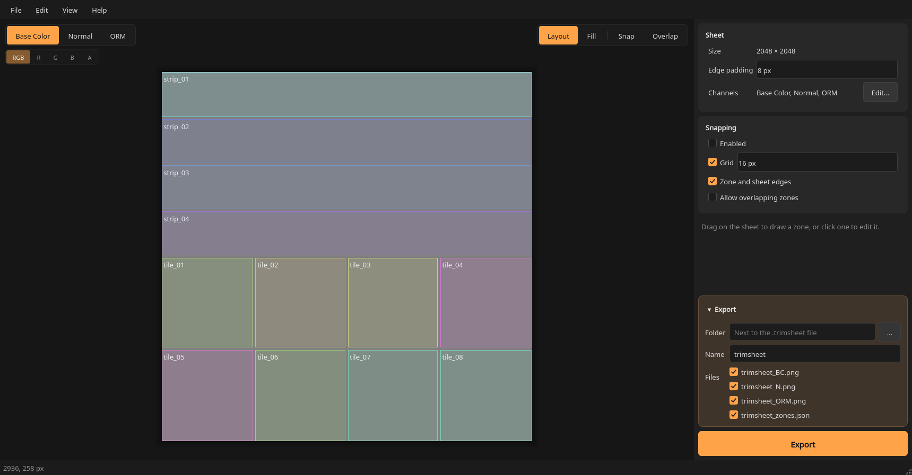

# Trim Sheet Builder

Simple tool for making trim sheets. Lay out zones, drop textures into them, export.



## What it does

- **Layout mode**: draw, move and resize zones. Grid and edge snapping, optional overlap blocking, per-zone lock. A bunch of layout presets for new sheets.
- **Fill mode**: zones are locked, you assign textures. Stretch / tile / fit / crop, rotation, flips, scale and offset.
- **Channels**: Base Color, Normal, ORM or whatever set you need. Pack separate textures into R / G / B / A (e.g. AO + roughness + metallic into ORM).
- **Normal maps** get rotated properly and can be flipped between DirectX and OpenGL.
- **Live textures**: linked files reload when you save them in another app.
- **Paste**: image paths, copied files or raw image data. Textures can be linked or embedded in the project file.
- **Export**: one PNG per channel with edge padding, plus `_zones.json` with every zone's rect and UVs.

## Download

Grab the AppImage (Linux) or zip (Windows) from [Releases](../../releases).

## Building

Needs CMake 3.21+, a C++17 compiler, Qt 6.4+ and libzip.

```sh
cmake -S . -B build -DCMAKE_BUILD_TYPE=Release
cmake --build build -j
./build/trimsheet
```

AppImage: `./packaging/build-appimage.sh`. It downloads the packaging tools on first run, nothing extra needed in the repo.

## Shortcuts

| | |
|---|---|
| Ctrl+1 / Ctrl+2 | Layout / Fill mode |
| Drag on empty sheet | New zone |
| Ctrl while dragging | Invert snapping |
| Shift+Tab | Snapping on / off |
| Wheel / right drag | Zoom / pan |
| Home | Fit sheet |
| Drag on a number field | Change value (Shift fine, Ctrl snap) |
| Ctrl+V | Paste texture into the selected zone |
| Ctrl+E | Export |

All shortcuts can be changed in *Edit → Preferences*.

## File format

`.trimsheet` is a zip with `project.json` and the embedded / cached textures in `textures/`.

## License

MIT
